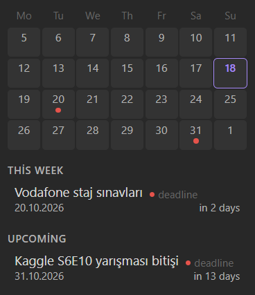

# Agenda Panel

An Obsidian plugin that shows the dated tasks and events from one plain Markdown file as an agenda in the right sidebar: a four-week calendar on top, a grouped list below.



- **One source file.** All dated items live in a single Markdown file. The plugin only reads it and never changes it.
- **Four-week calendar.** Last week, this week and the next two weeks, with colored dots on the days that have items.
- **Grouped list.** Today, This week, Upcoming and Past, each item with its remaining days.
- **Click to open.** Clicking an item opens the note it links to.
- **Configurable.** File path, date format, item types with their own colors, and whether completed items are shown.
- **No network, no telemetry.** The plugin reads one file in your vault and nothing else.

## Agenda file format

Each agenda item is one line:

```
- 📅 20.10.2026 | deadline | Submit the report | [[Project notes]]
```

| Field | Meaning |
| --- | --- |
| `📅 20.10.2026` | The date, written in the format you chose in the settings. |
| `deadline` | The item type. It decides the color. Any text is allowed. |
| `Submit the report` | The title shown in the panel. |
| `[[Project notes]]` | Optional. The note that opens on click. `[[note\|alias]]` and `[[note#heading]]` work too. |

To mark an item as completed, put `✅` at the start of the line, before or after the list marker:

```
- ✅ 📅 01.10.2026 | task | Pay the invoice | [[Finance]]
```

Completed items are kept in the file and hidden in the panel by default. Lines that do not match the format, including lines with a date in a different format, are ignored.

> **Important:** dates must be written in the format selected in the plugin settings. If you change the format, existing lines written in the old format stop showing up until you rewrite them.

### Who writes the lines?

You do, by hand, or any tool or AI assistant you point at the file. The plugin does not scan your other notes for dates. If you use an AI assistant, tell it the line format above and the file path, and it can add items for you.

## Settings

| Setting | Description |
| --- | --- |
| Agenda file | Path of the agenda file, relative to the vault root. Default: `Agenda.md`. |
| Date separator | The character between day, month and year: `.`, `/` or `-`. |
| Date order | Any order of `DD`, `MM` and `YYYY`, for example `DD.MM.YYYY`, `MM/DD/YYYY` or `YYYY-MM-DD`. |
| Show completed items | Show items marked with `✅`. Off by default. |
| Types | The list of item types. Rename them, change their colors, remove them, or add your own. |

Four types come with default colors: `task`, `event`, `deadline` and `reminder`. Type names are matched without regard to case. An item whose type is not in the list is shown in gray. You can rename the types to your own language.

## Usage

1. Create the agenda file and add a few lines.
2. In the plugin settings, set **Agenda file** and the date format.
3. Open the panel from the calendar icon in the ribbon, or run the command **Open agenda panel**.

The panel refreshes when the file changes and when the date changes at midnight. Weeks start on Monday.

## Installation

### From a release (manual)

1. Download `main.js`, `manifest.json` and `styles.css` from the latest [release](https://github.com/emirhanoguz0/obsidian-agenda-plugin/releases).
2. Put them in `<your vault>/.obsidian/plugins/agenda-panel/`.
3. In Obsidian, open **Settings → Community plugins**, turn off Restricted mode, reload the plugin list and enable **Agenda Panel**.

### From source

Requires a current Node.js LTS release.

```bash
git clone https://github.com/emirhanoguz0/obsidian-agenda-plugin.git
cd obsidian-agenda-plugin
npm install
npm run build
npm run deploy -- "<path to your vault>"
```

Then enable the plugin as described above.

## Development

```bash
npm test          # unit tests
npm run build     # type check and production bundle
npm run dev       # rebuild on change
```

The parsing, grouping, calendar and date logic is kept free of Obsidian imports so it can be tested on its own.

## License

[MIT](LICENSE)
